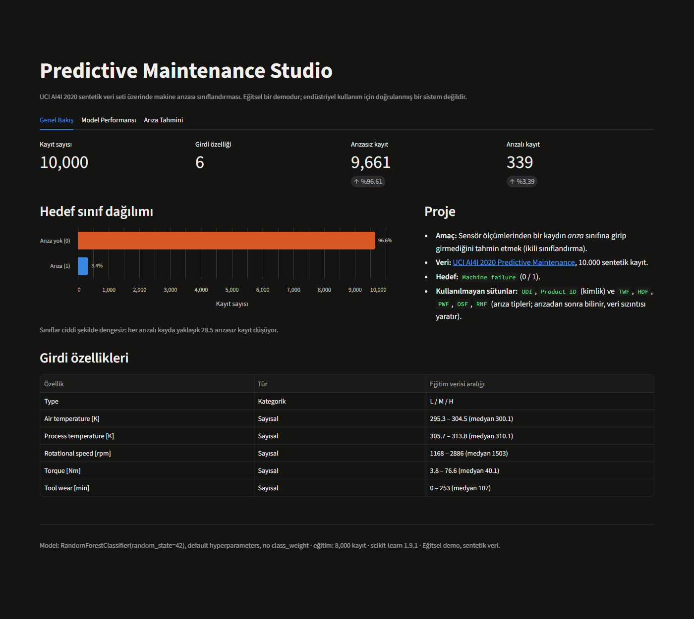
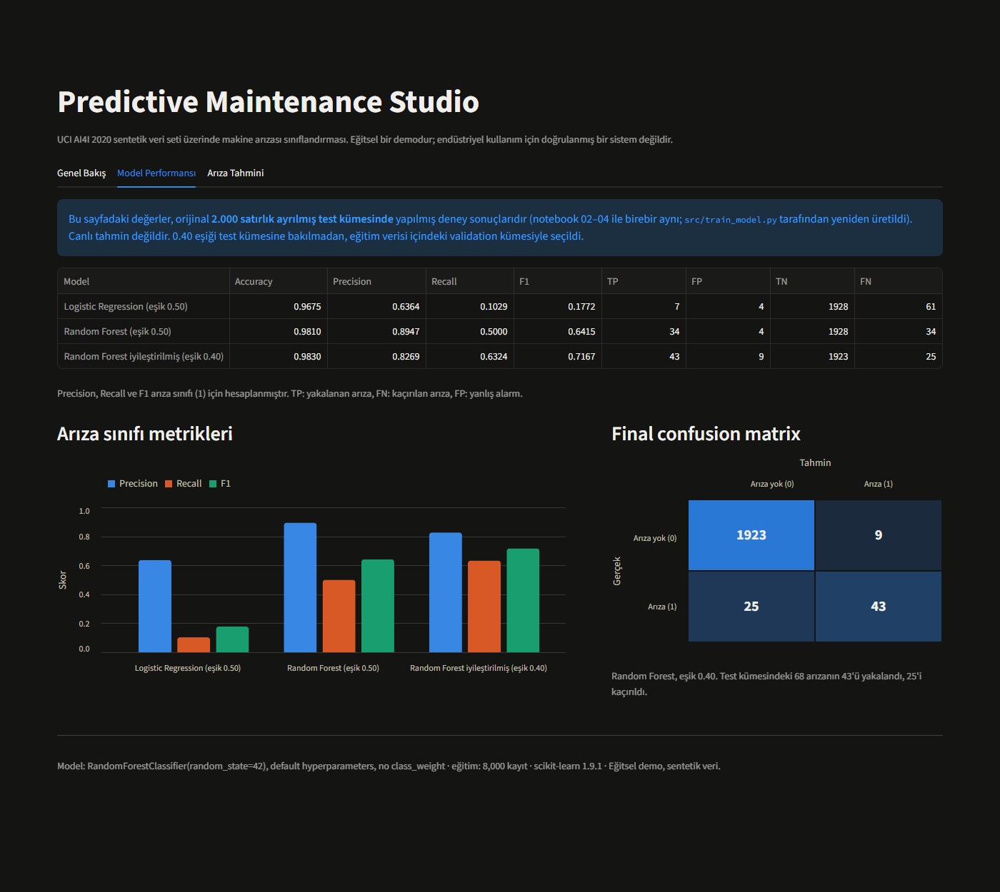
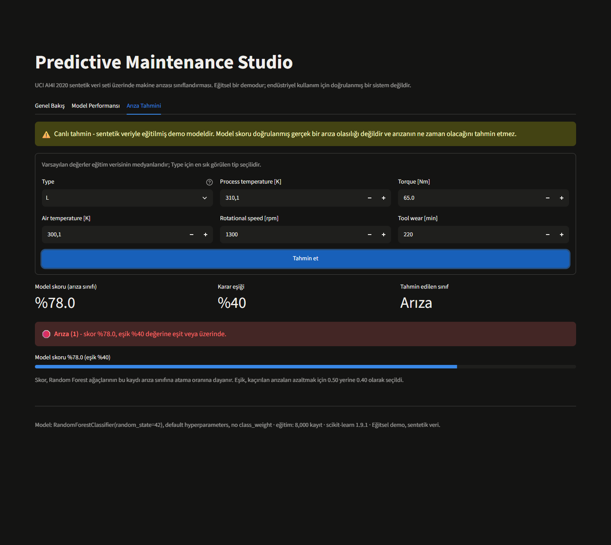

# Predictive Maintenance Studio

Sensör ölçümlerinden bir makine kaydının **arıza** (`Machine failure = 1`) sınıfına girip girmediğini tahmin eden, eğitsel bir ikili sınıflandırma projesi. Veri keşfinden model iyileştirmeye kadar tüm adımlar Jupyter not defterlerinde; final model bir Streamlit panosunda sunulur.

> Bu proje **sentetik veriyle** hazırlanmış bir öğrenme/portföy çalışmasıdır. Endüstriyel kullanım için doğrulanmış bir kestirimci bakım sistemi değildir ve arızanın ne zaman olacağını tahmin etmez.

## Veri seti

- **Kaynak:** [UCI AI4I 2020 Predictive Maintenance Dataset](https://archive.ics.uci.edu/dataset/601/ai4i+2020+predictive+maintenance+dataset)
- `data/ai4i2020.csv`: 10.000 kayıt, 14 sütun, eksik veya tekrarlı satır yok. Dosya UTF-8 BOM ile başlar; `encoding="utf-8-sig"` ile okunur. Orijinal dosya değiştirilmez.
- **Girdi özellikleri (6):** `Type`, `Air temperature [K]`, `Process temperature [K]`, `Rotational speed [rpm]`, `Torque [Nm]`, `Tool wear [min]`
- **Hedef:** `Machine failure`. 9.661 arızasız, 339 arızalı kayıt (%3.39); sınıflar ciddi şekilde dengesiz.
- **Modele girmeyen sütunlar:** `UDI`, `Product ID` kimlik sütunlarıdır. `TWF`, `HDF`, `PWF`, `OSF`, `RNF` arıza tipi etiketleridir; arızadan sonra bilindikleri için girdi olarak kullanılırsa veri sızıntısı yaratırlar.

## Proje yapısı

```
app.py                     Streamlit panosu (yalnızca sunum ve tahmin; eğitim yapmaz)
src/config.py              Ortak yollar, özellik listesi, karar eşiği
src/train_model.py         Final modeli eğitir, doğrular ve kaydeder
src/predict.py             Modeli yükler, girdiyi doğrular, tahmin yapar
models/                    Üretilen model (joblib) ve metadata (JSON)
notebooks/                 Aşama aşama analiz not defterleri
data/ai4i2020.csv          Orijinal veri
.streamlit/config.toml     Koyu tema ayarları
docs/screenshots/          README'deki uygulama ekran görüntüleri
```

## Not defterleri

| Not defteri | İçerik |
|---|---|
| `01_veri_analizi.ipynb` | Veri yapısı, eksik/tekrarlı veri, istatistikler, sınıf dağılımı, sızıntı riski |
| `02_logistic_regression.ipynb` | 80/20 stratified ayrım, Pipeline ile Logistic Regression, Dummy karşılaştırması |
| `03_model_karsilastirma.ipynb` | Dummy, Logistic Regression ve Random Forest karşılaştırması, özellik önemi |
| `04_model_iyilestirme.ipynb` | Eğitim verisi içinde validation ayrımı, `class_weight` ve karar eşiği denemeleri |

## Model sonuçları

Tüm sonuçlar orijinal **2.000 satırlık ayrılmış test kümesinde** ölçülmüştür. Precision, Recall ve F1 arıza sınıfı (1) içindir.

| Model | Accuracy | Precision | Recall | F1 | TP | FP | TN | FN |
|---|---|---|---|---|---|---|---|---|
| Logistic Regression (eşik 0.50) | 0.9675 | 0.6364 | 0.1029 | 0.1772 | 7 | 4 | 1928 | 61 |
| Random Forest (eşik 0.50) | 0.9810 | 0.8947 | 0.5000 | 0.6415 | 34 | 4 | 1928 | 34 |
| **Random Forest (eşik 0.40) - final** | **0.9830** | **0.8269** | **0.6324** | **0.7167** | **43** | 9 | 1923 | **25** |

**Final model:** `RandomForestClassifier(random_state=42)`; varsayılan parametreler, `class_weight` yok. Sayısal sütunlar olduğu gibi kullanılır, `Type` one-hot kodlanır. Model 8.000 eğitim kaydıyla eğitilir ve karar eşiği **0.40**'tır.

Eşik, test kümesine bakılmadan seçilmiştir: eğitim verisi içinde ayrılan validation kümesinde, "precision ≥ 0.70 olanlar arasında en yüksek recall" kuralıyla.

## Kurulum

Windows, Python 3.13:

```bash
python -m venv .venv
.venv\Scripts\activate
pip install -r requirements.txt
```

> Model dosyası, onu eğiten scikit-learn sürümüne bağlıdır (1.9.1). Komutları her zaman projenin `.venv` ortamında çalıştırın. Sürüm uyuşmazsa uygulama modeli yüklemez ve yeniden eğitmenizi ister.

## Modeli eğitme

Komutu proje klasöründe çalıştırın:

```bash
python -m src.train_model
```

Bu komut:
1. Modeli eğitir.
2. Test sonuçlarını not defterleriyle karşılaştırır; uyuşmazlık varsa durur.
3. Kaydedilen modeli yeniden yükleyip aynı skorları verdiğini kontrol eder.
4. `models/final_model.joblib` ve `models/model_metadata.json` dosyalarını oluşturur.

## Uygulamayı çalıştırma

```bash
streamlit run app.py
```

Uygulamada üç sekme var:

- **Genel Bakış:** veri seti özeti ve sınıf dağılımı
- **Model Performansı:** daha önce yapılmış deneylerin test sonuçları ve final confusion matrix
- **Arıza Tahmini:** altı girdiyle canlı tahmin (model skoru, 0.40 eşiği ve tahmin edilen sınıf)

### Ekran görüntüleri

**Genel Bakış:** veri seti özeti, sınıf dağılımı ve girdi özelliklerinin aralıkları



**Model Performansı:** test kümesindeki deney sonuçları ve final confusion matrix



**Arıza Tahmini:** örnek girdi (Type L, 1300 rpm, 65 Nm tork, 220 dk takım aşınması) için tahmin; skor %78 ≥ eşik %40, sonuç: arıza



Uygulama modeli eğitmez. Kaydedilmiş modeli bir kez yükler ve önbellekte tutar. Model dosyası yoksa veya bozuksa, eğitim komutunu gösteren bir hata mesajı verir.

Yalnızca bu proje tarafından yerel olarak üretilmiş `joblib` dosyalarını yükleyin. Joblib/pickle dosyaları güvenilmeyen kaynaklardan açılmamalıdır.

## Sınırlamalar

- Veri **sentetiktir** ve yalnızca 339 arıza örneği içerir. Test kümesinde 68 arıza vardır, bu yüzden birkaç kayıtlık fark bile metrikleri belirgin şekilde değiştirir.
- Final model test kümesindeki 68 arızanın **25'ini hâlâ kaçırmaktadır**.
- Model skoru, Random Forest ağaçlarının oylamasına dayanan bir değerdir. **Kalibre edilmiş, gerçek dünyada doğrulanmış bir arıza olasılığı değildir.**
- Model arıza **zamanını** veya kalan ömrü tahmin etmez. Yalnızca verilen anlık ölçümler için bir sınıf tahmini yapar.
- Eğitim verisi aralığı dışındaki girdiler kabul edilir ama uyarı verilir; bu girdilerde model güvenilirliği düşer.
- Sonuçlar scikit-learn sürümüne bağlı olabilir. Not defterleri ve model scikit-learn 1.9.1 ile doğrulanmıştır.
